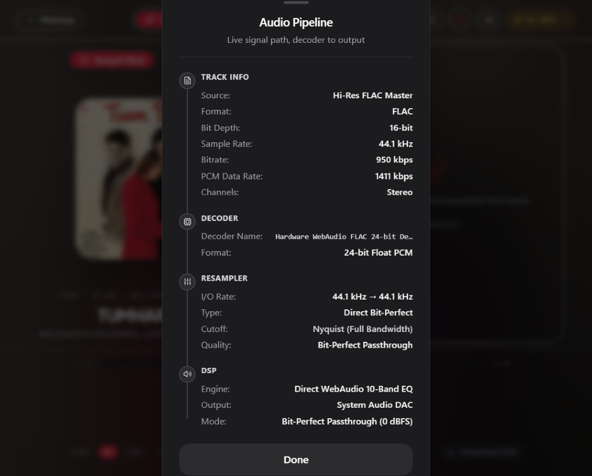
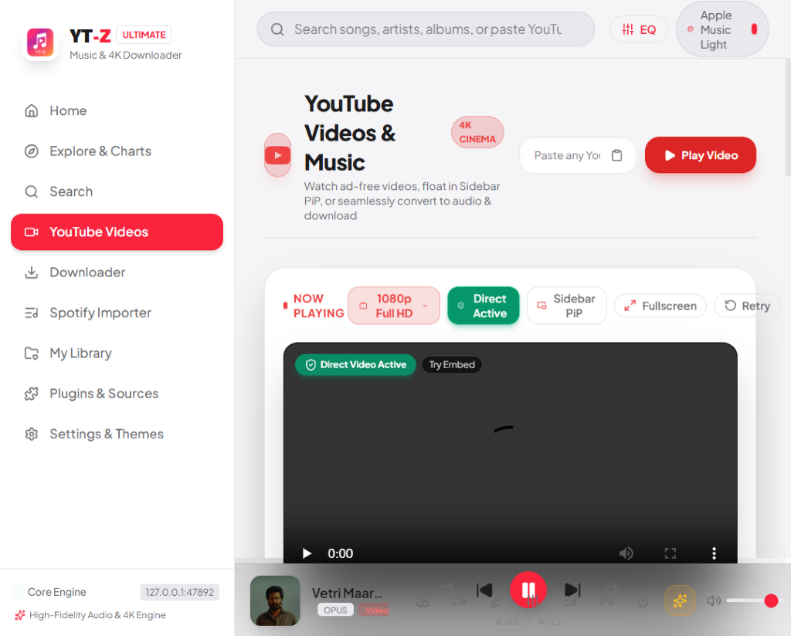
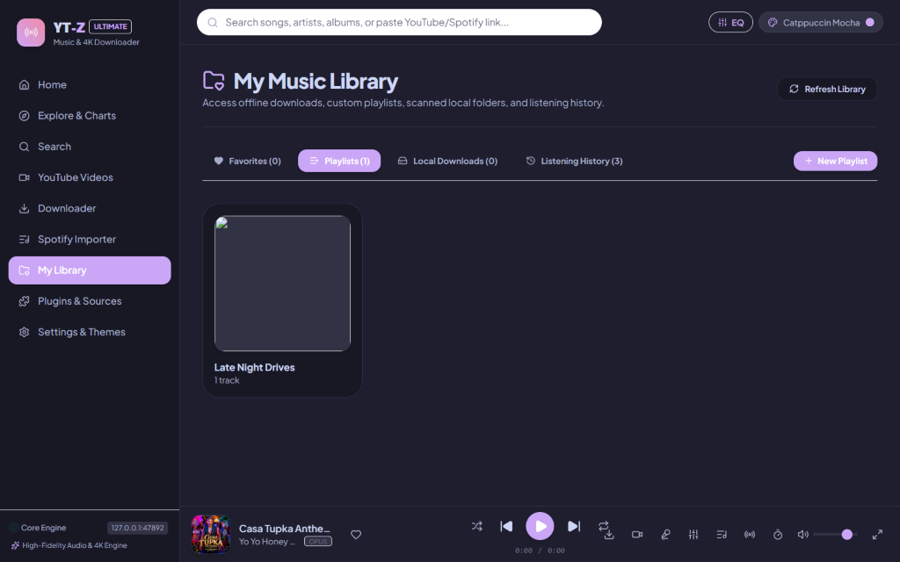

<div align="center">
  
  <h1>YT-Z — Ultimate YouTube Music & Hi-Fi Downloader</h1>
  <p><strong>Pure 24-Bit Lossless Audio • 4K Video Cinema • Bit-Perfect Downloads • No Ads • Self-Hosted</strong></p>

  <p>
    
    
    
    
    
    
    
    
  </p>

  <p>
    <a href="#-key-pillars">Key Pillars</a> •
    <a href="#-features">Features</a> •
    <a href="#-screenshots">Screenshots</a> •
    <a href="#-getting-started">Getting Started</a> •
    <a href="#-keyboard-shortcuts">Shortcuts</a> •
    <a href="#️-architecture">Architecture</a> •
    <a href="#-contributing">Contributing</a>
  </p>
</div>

---

> **YT-Z** is an open-source, self-hosted audiophile music streaming, cinema video player, and 4K media downloader powered by YouTube Music and decentralized Hi-Res FLAC sources. It combines the refined elegance of Apple Music (fluid ambient mesh visualizer, word-by-word synced karaoke lyrics, studio equalizer) with audiophile bit-perfect signal processing, zero ads, zero tracking, and native offline storage.

---

## 🌟 Key Pillars

### 🎼 1. Hi-Res Lossless Audio Architecture (24-bit / 96kHz FLAC)
- **Multi-Source Parallel Resolver**: Queries pluggable Hi-Res FLAC audio sources simultaneously in sub-second parallel threads with in-flight deduplication and instant fallback to 256k YouTube Music Opus.
- **Hardware WebAudio Pipeline**: Inspect live signal paths from stream input to hardware DAC:
  $$\text{Source Master (FLAC 24-bit)} \longrightarrow \text{Hardware Decoder} \longrightarrow \text{Nyquist Resampler} \longrightarrow \text{10-Band EQ DSP} \longrightarrow \text{System DAC}$$
- **Zero-Lag Streaming Proxy**: HTTP partial range (206) proxying with client-disconnect detection ensures instantaneous pause, seek, and resume without buffer stutter or Heroku connection leaks.

### 🔬 2. Live Audio Pipeline Diagnostics ("Stats for Nerds")
- Real-time audiophile inspector modal displaying track source, bit-depth (16-bit / 24-bit float), sample rate (44.1 kHz / 96.0 kHz), bitrate ($1411+$ kbps), hardware decoder status, Nyquist full-bandwidth filter cutoff, and bit-perfect passthrough (0 dBFS).

### 🎬 3. YouTube Video Cinema & Direct Bypass (4K & 1080p)
- **Cinema Mode**: Watch official music videos in full 1080p Full HD or 4K Ultra HD.
- **Auto-Bypass for Restricted Embeds (Error 150/152)**: Automatically detects when record labels (e.g. T-Series, Saregama) restrict embedding on third-party sites, seamlessly switching to a progressive direct HTML5 video stream (`/api/stream/{video_id}/video`).
- **Mutual Exclusion & Zero Dual-Playback**: Video and audio states are strictly coordinated—starting a video automatically stops and unloads all audio streams; playing an audio track immediately terminates and unloads active videos.
- **Sidebar PiP**: Dock running videos into a persistent mini-window while exploring search, charts, or your library.

### 📥 4. Download at Original Playing Quality (1-Click Bit-Perfect FLAC)
- **True Original Fidelity**: When listening to Hi-Res Lossless FLAC, the 1-click download button automatically resolves and pulls the original bit-perfect FLAC master stream directly rather than re-encoding a lossy YouTube copy.
- **Multi-Format Studio Converter**: Download at 320kbps MP3, FLAC, M4A, Opus, WAV, or 4K MP4/MKV.
- **Automatic ID3 Tagging & Album Art**: Automatically embeds title, artist, album, and high-resolution cover art into downloaded files.

### 🎤 5. Apple Music-Style Synced Karaoke Lyrics
- Word-by-word and syllable-level highlighted synchronization powered by LRCLIB and community LRC providers.
- Supports **Split View** (album vinyl + lyrics side-by-side) and **Fullscreen Lyrics Mode** with responsive fluid ambient background blur.

### 🎨 6. 30+ Visual Themes & Apple Music Fluid Mesh
- High-contrast, meticulously calibrated theme engine: **Apple Music Dark**, **Apple Music Light**, **OLED Pure Black**, **Cyberpunk Neon**, **Tokyo Night**, **Catppuccin Mocha**, **Dracula**, **Nord**, and more.
- Multi-layer canvas visualizer derived from album artwork with blurred base scrim and floating organic mesh orbs.

---

## ✨ Features Breakdown

### 🎵 Audio & Streaming
| Feature | Details |
|---|---|
| **Hi-Res FLAC Streaming** | Native bit-perfect 16-bit/44.1kHz and 24-bit/96kHz FLAC via pluggable add-ons |
| **Adaptive Quality Selector** | Choose Lossless (FLAC), High (256k-320k), Standard (128k-160k), or Data Saver (48k-70k Opus) |
| **10-Band Studio Equalizer** | Interactive spline curve with 9 audiophile presets (Flat, Bass Boost, Vocal, Rock, Classical…) |
| **Audio Pipeline Modal** | Full hardware signal path diagnostics: Source, Decoder, Nyquist Cutoff, DSP, DAC |
| **SponsorBlock Integration** | Automatically skips sponsored segments, intros, outros, and music off-topic sections |
| **Radio Mode** | Infinite algorithmic song radio generated from any seed track |
| **Sleep Timer** | Custom countdown with gentle volume fade-out |
| **Volume Normalization** | ReplayGain-style automatic loudness equalization |

### 📺 Video & Cinema
| Feature | Details |
|---|---|
| **YouTube Cinema Theater** | High-definition music video playback with resolution selector (4K, 1440p, 1080p, 720p, 360p) |
| **Error 150/152 Auto-Bypass** | Direct HTML5 progressive video proxy bypasses third-party embed blocks |
| **Sidebar PiP & Fullscreen** | Persistent floating picture-in-picture across all navigation pages |
| **Mutual Audio/Video Sync** | Guaranteed zero overlapping sound: audio cleanly unloads when video plays |

### 📥 Downloader & Importers
| Feature | Details |
|---|---|
| **Original Audio Download** | Automatically downloads the exact playing stream (FLAC Master or high-bitrate Opus/MP3) |
| **4K Video Downloader** | Save high-resolution MP4/MKV video with embedded subtitles |
| **Spotify Playlist Importer** | Paste any Spotify playlist, album, or track URL — auto-matches and downloads |
| **ID3 Tag Editor** | Edit title, artist, album, year, and genre directly within the download manager |
| **Batch Downloader** | Multi-threaded concurrent download queue with real-time speed, ETA, and progress |

### 📚 Library & Personalization
| Feature | Details |
|---|---|
| **Custom Playlists** | Create, edit, and reorder playlists with automatic first-track cover art or custom uploads |
| **Listening & Search History** | Persistent SQLite storage for listening history and search query caching |
| **Favorites Collection** | 1-click heart favorite songs for instant offline library access |
| **Session Restoration** | Automatically restores queue, current track, timeline position, repeat, and volume on launch |
| **30+ Visual Themes** | 100% solid, high-contrast modal backdrops with support for light and dark modes |
| **Desktop PWA & Native Rust App** | Available as a web PWA or native lightweight Rust/Tauri v2 desktop client |

---

## 📸 Screenshots

### 🏠 Home & Search Autocomplete


> Real-time autocomplete suggestions layered seamlessly over the hero banner with instant keyboard navigation.

---

### 🔬 Live Audio Pipeline Diagnostics ("Stats for Nerds")


> Live signal path inspector showing active Hi-Res FLAC Master source, hardware WebAudio 24-bit decoder, Nyquist full-bandwidth cutoff, and bit-perfect DAC output.

---

### 🎬 YouTube Cinema Player (1080p & 4K with Direct Bypass)


> Direct progressive video player bypassing YouTube Error 150/152 embed blocks with resolution selection and Sidebar PiP.

---

### 🎵 Expanded Player — Apple Music Ambient Mesh


> Dynamic color-shifting organic mesh background derived from album artwork with word-by-word synced lyrics.

---

### 📚 Custom Playlists & Library


> Manage playlists with automatic track cover art fallbacks and drag-and-drop reordering.

---

## 🚀 Getting Started

### Prerequisites
- **Python 3.10+** — [python.org](https://www.python.org/downloads/)
- **Node.js 18+** — [nodejs.org](https://nodejs.org/)
- **Git** — [git-scm.com](https://git-scm.com/)
- *(Optional for Native Desktop)*: **Rust & Cargo** — [rust-lang.org](https://www.rust-lang.org/)

---

### Option A: Web App / PWA (Python + React)

```bash
# 1. Clone the repository
git clone https://github.com/mohd98zaid/YT-Z.git
cd YT-Z

# 2. Install Python backend dependencies
pip install -r requirements.txt

# 3. Install frontend dependencies & build bundle
npm install --prefix frontend
npm run build --prefix frontend

# 4. Start the server
python -m backend.server
```

Open **http://127.0.0.1:47892** in your browser.

> **Tip:** In Google Chrome, Microsoft Edge, or Safari, click **Install YT-Z** in the address bar to install it as a standalone desktop application.

---

### Option B: Native Rust / Tauri v2 Desktop App

YT-Z includes a native, lightweight Rust desktop runtime powered by Tauri v2:

```bash
# Navigate to the Rust workspace
cd YT-Z-rust

# Install dependencies
npm install

# Run in desktop development mode
cargo tauri dev

# Build production installer (.exe / .msi / .deb / .dmg)
cargo tauri build
```

---

## 🎹 Keyboard Shortcuts

Press `?` anywhere in the app to display the live shortcut overlay:

| Key | Action |
|---|---|
| `Space` | Play / Pause active stream |
| `→` | Seek 10 seconds forward |
| `←` | Rewind 10 seconds backward |
| `Shift + →` | Next track in queue |
| `Shift + ←` | Previous track |
| `↑` / `↓` | Increase / Decrease volume |
| `M` | Mute / Unmute audio |
| `L` | Toggle Synced Lyrics panel |
| `F` | Toggle Fullscreen Lyrics / Video |
| `S` | Toggle Shuffle |
| `R` | Cycle Repeat (Off / All / One) |
| `D` | Download currently playing track |
| `?` | Open Keyboard Shortcuts HUD |
| `Esc` | Close modal / collapse player |

---

## ⚙️ Configuration & Data Storage

YT-Z stores all configuration, local caches, and database files in your user home directory:

```
~/.ytz/
├── ytz.db           # SQLite database (playlists, listening history, favorites)
├── cache/           # Stream cache & album art cache (auto-managed)
└── downloads/       # Downloaded FLAC/MP3 audio and 4K video files
```

You can view live cache usage, purge the stream cache, or customize download directories directly from the **Settings & Themes** page.

---

## 🏗️ Architecture

```
YT-Z/
├── backend/                       # Python FastAPI Backend
│   ├── server.py                  # Main server & WebSocket manager (port 47892)
│   ├── core/
│   │   ├── database.py            # SQLite schema (playlists, history, downloads)
│   │   └── config.py              # Configuration manager
│   └── api/
│       ├── stream.py              # Multi-engine audio resolver with in-flight deduplication
│       ├── addon_source.py        # Hi-Res Lossless FLAC module parallel resolver
│       ├── downloader.py          # yt-dlp & direct FLAC master download engine
│       ├── search.py              # YouTube Music search & auto-complete API
│       ├── lyrics.py              # Multi-provider synced lyrics engine
│       ├── plugins.py             # Addon module source manager
│       └── spotify_importer.py    # Spotify link resolver & matcher
│
├── frontend/                      # React 18 + TypeScript + Vite
│   └── src/
│       ├── components/
│       │   ├── Header.tsx         # Search bar, theme switcher, shortcuts trigger
│       │   ├── Sidebar.tsx        # Navigation tabs & mini video PiP anchor
│       │   └── Player/
│       │       ├── MiniPlayer.tsx            # Persistent bottom bar & quality menu
│       │       ├── ExpandedPlayer.tsx        # Apple Music ambient visualizer
│       │       ├── PersistentVideoPlayer.tsx # Direct bypass YouTube player
│       │       ├── AudioPipelineModal.tsx    # Hardware signal path diagnostics
│       │       └── EqualizerModal.tsx        # 10-Band studio equalizer
│       ├── pages/                 # Home, Explore, YouTube, Downloader, Library, Settings...
│       ├── stores/                # Zustand stores (usePlayerStore, useVideoStore, useThemeStore)
│       └── themes/presets.ts      # 30+ curated color themes
│
├── YT-Z-rust/                     # Native Rust / Tauri v2 Desktop Client
├── docs/screenshots/              # Documentation assets
├── requirements.txt               # Backend Python dependencies
└── README.md
```

---

## 🤝 Contributing

Contributions are warmly welcomed!

1. **Fork** the repository
2. **Create** your feature branch: `git checkout -b feat/my-new-feature`
3. **Commit** your changes: `git commit -m 'feat: add amazing capability'`
4. **Push** to your branch: `git push origin feat/my-new-feature`
5. **Open a Pull Request**

### Development Mode

```bash
# Backend auto-reload
uvicorn backend.server:app --reload --port 47892

# Frontend hot-reload
npm run dev --prefix frontend
```

---

## 📜 License

This project is licensed under the **GNU General Public License v3.0**. See the [LICENSE](LICENSE) file for complete details.

---

## 🙏 Acknowledgements

- [ytmusicapi](https://github.com/sigma67/ytmusicapi) — Unofficial YouTube Music API
- [yt-dlp](https://github.com/yt-dlp/yt-dlp) — Media extraction & downloading engine
- [LRCLIB](https://lrclib.net/) — Open synced lyrics database
- [SponsorBlock](https://sponsor.ajay.app/) — Community-powered video segment skipping
- [Tauri](https://tauri.app/) — Next-generation native desktop framework
- [Lucide Icons](https://lucide.dev/) — Clean, consistent icons

---

<div align="center">
  Built with ❤️ by <a href="https://github.com/mohd98zaid">Mohd Zaid</a>.
  <br/><br/>
  <strong>⭐ Star this repo on GitHub if you enjoy using YT-Z! ⭐</strong>
</div>
