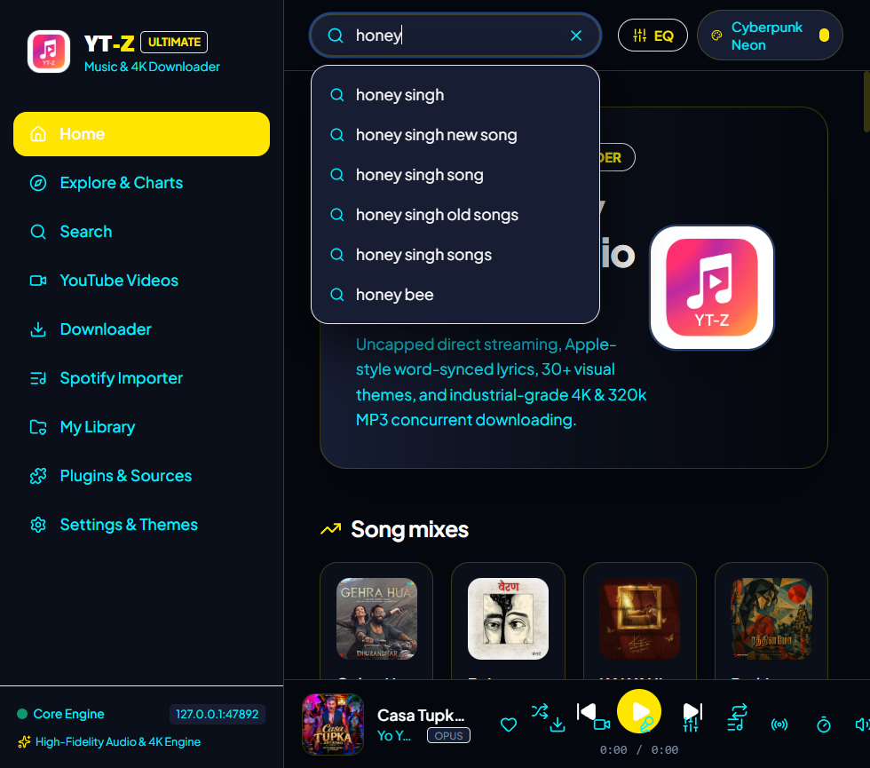
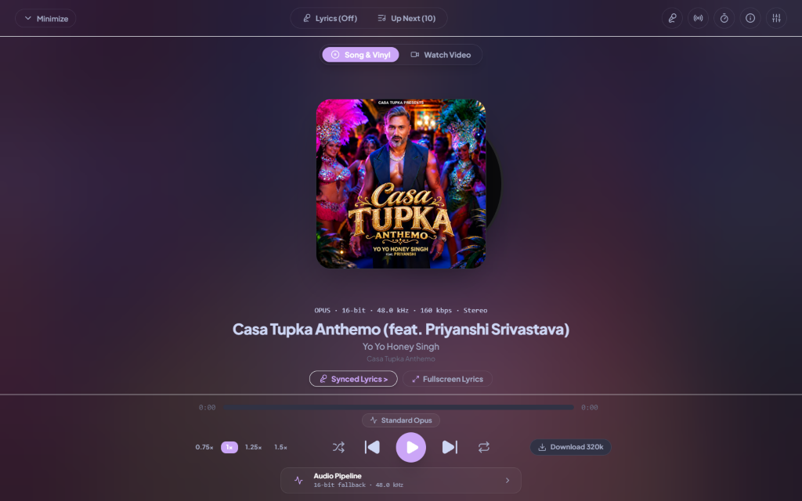
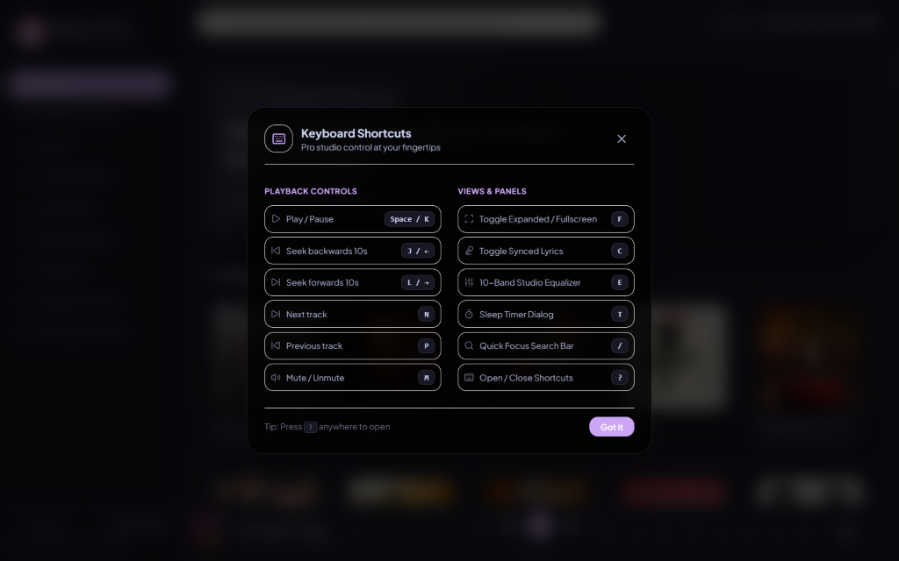
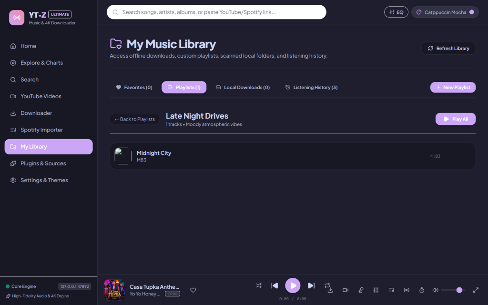
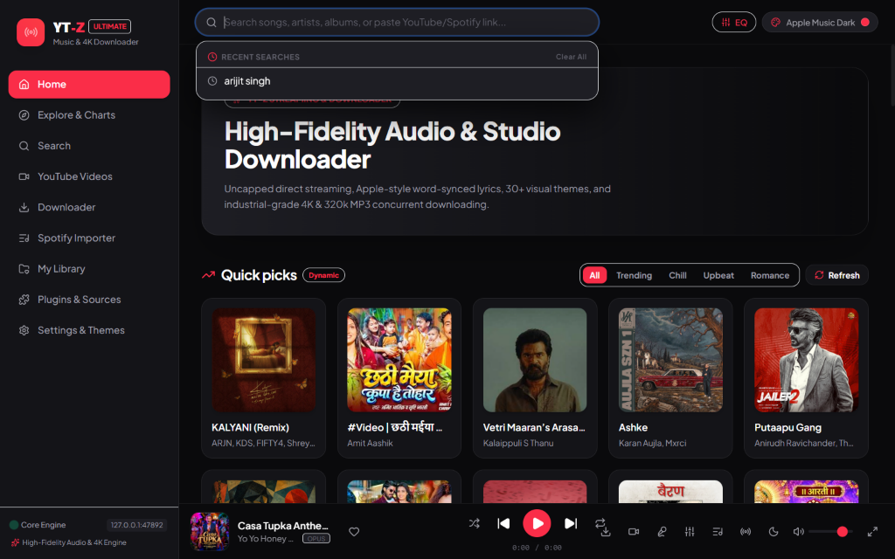
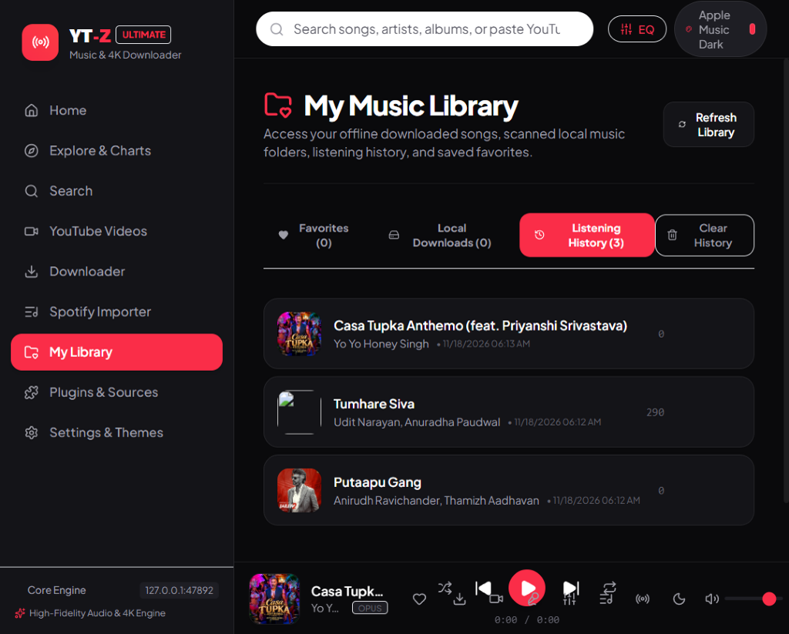
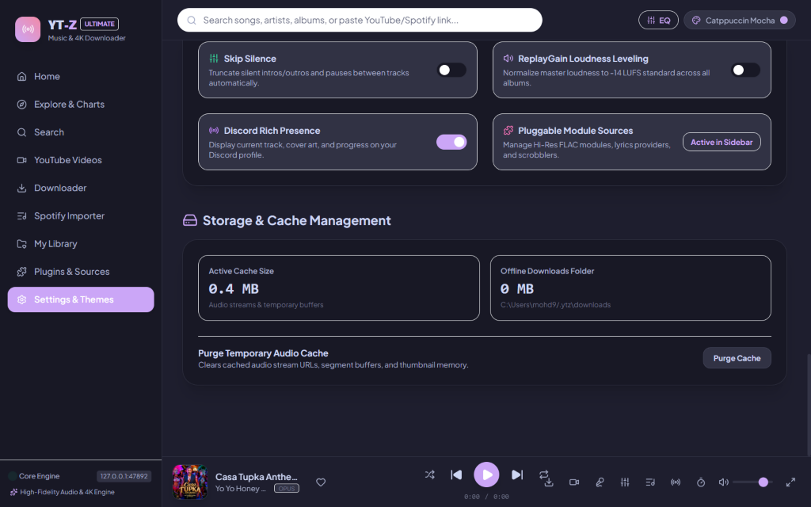

<div align="center">
  
  <h1>YT-Z — Ultimate YouTube Music & Hi-Fi Downloader</h1>
  <p><strong>Stream lossless audio. Download at 4K & 320kbps. No ads. No limits.</strong></p>

  <p>
    
    
    
    
    
    
  </p>

  <p>
    <a href="#-features">Features</a> •
    <a href="#-screenshots">Screenshots</a> •
    <a href="#-getting-started">Getting Started</a> •
    <a href="#-keyboard-shortcuts">Shortcuts</a> •
    <a href="#️-architecture">Architecture</a> •
    <a href="#-contributing">Contributing</a>
  </p>
</div>

---

> **YT-Z** is a self-hosted, full-featured music streaming and downloading app powered by YouTube Music. Think Spotify Premium — but for YouTube Music, running 100% locally on your machine, with Hi-Res audio, a studio equalizer, Apple Music-style synced lyrics, and a 4K concurrent downloader.

---

## ✨ Features

### 🎵 Audio & Streaming
| Feature | Details |
|---|---|
| **Hi-Res Lossless Streaming** | Multi-engine waterfall resolver: Lossless Module → YouTube Opus → Mobile Client → Piped/Invidious fallback |
| **10-Band Studio Equalizer** | Real-time frequency curve, 9 built-in presets (Flat, Bass Boost, Rock, Jazz, Classical…) |
| **Gapless Pre-buffering** | 25-second lookahead pre-buffer for seamless track transitions |
| **SponsorBlock Integration** | Auto-skip sponsor segments, intros, outros, and self-promos |
| **Radio Mode** | Auto-queue similar tracks — endless listening from any song |
| **Sleep Timer** | Set a countdown; playback gracefully fades and stops |

### 📺 Video & Lyrics
| Feature | Details |
|---|---|
| **YouTube Video Player** | Watch the actual music video — bypasses Error 150/152 via direct proxy |
| **Apple Music–style Synced Lyrics** | Word-by-word highlighted lyrics via LRCLIB, falls back to plain LRC |
| **Fullscreen Lyrics Mode** | Immersive full-screen lyric view with artwork blur background |
| **Split View** | Artwork + lyrics side-by-side in expanded player |
| **Artwork-Only Mode** | Clean hi-res artwork display while listening |

### 📥 Downloader
| Feature | Details |
|---|---|
| **320kbps MP3 Download** | Download any track at studio-grade 320kbps MP3 |
| **4K Video Download** | Download music videos at up to 4K resolution |
| **Concurrent Downloads** | Multiple simultaneous downloads with per-track progress |
| **ID3 Tag Editor** | Edit title, artist, album, year, genre on any downloaded file |
| **Spotify Playlist Importer** | Paste any Spotify playlist URL — YT-Z matches and downloads every track |

### 📚 Library & History
| Feature | Details |
|---|---|
| **Custom Playlists** | Create, rename, reorder, and delete your own playlists |
| **Listening History** | Full playback history saved to SQLite — browse "Recently Played" |
| **Search History** | Persistent search history with per-entry delete and clear-all |
| **Session Restoration** | Queue, current track, volume, repeat, and shuffle restored on every launch |
| **Favorites** | Heart any track; browse your collection in My Library |

### 🎨 UI & Personalization
| Feature | Details |
|---|---|
| **30+ Visual Themes** | Cyberpunk Neon, Dracula, Solarized, Monokai, Nord, Catppuccin, and more |
| **Apple Music Ambient Mesh** | Fluid color-shifting background in the expanded player |
| **Stats for Nerds** | Audio pipeline modal — codec, bitrate, sample rate, buffer state |
| **Keyboard Shortcuts HUD** | Press `?` for a full overlay of every keyboard shortcut |
| **PWA Installable** | Install as a native-like desktop app via your browser |
| **Windows MediaSession API** | Media key support (play/pause/skip) on Windows |
| **Storage & Cache Management** | View cache size, purge stream cache, manage downloads |

---

## 📸 Screenshots

### 🏠 Home & Search


> Live autocomplete suggestions dropdown — fully layered above the hero banner, no bleed-through.

---

### 🎵 Expanded Player — Apple Music Ambient Mesh


> Fluid color-shifting ambient mesh background derived from album artwork — just like Apple Music.

---

### 🎹 Keyboard Shortcuts HUD


> Press `?` anywhere to see the full shortcut reference overlay.

---

### 📚 Custom Playlists


> Create and manage your own playlists — add tracks, reorder, rename, delete.

---

### 🎶 Playlist Detail View


> Full playlist detail with track list, play-all, shuffle, and per-track options.

---

### 🕐 Listening History & Recent Searches
| Recent Searches | Listening History |
|---|---|
|  |  |

---

### ⚙️ Storage & Cache Management


> Live cache size tracking, one-click purge, and download folder management.

---

## 🚀 Getting Started

### Prerequisites

- **Python 3.10+** — [python.org](https://www.python.org/downloads/)
- **Node.js 18+** — [nodejs.org](https://nodejs.org/)
- **Git** — [git-scm.com](https://git-scm.com/)

### Installation

```bash
# 1. Clone the repository
git clone https://github.com/mohd98zaid/YT-Z.git
cd YT-Z

# 2. Install Python backend dependencies
pip install -r requirements.txt

# 3. Install frontend dependencies
npm install --prefix frontend

# 4. Build the frontend
npm run build --prefix frontend

# 5. Start the app
python -m backend.server
```

Then open **http://127.0.0.1:47892** in your browser. That's it. 🎉

> **Tip:** To install as a desktop app, open the URL in Chrome and click **Install** in the address bar (PWA support).

### First Run

On first launch, YT-Z will:
1. Create a local SQLite database at `~/.ytz/ytz.db`
2. Set up cache and downloads directories at `~/.ytz/`
3. Serve the web UI on `http://127.0.0.1:47892`

---

## 🎹 Keyboard Shortcuts

> Press `?` at any time to open the in-app shortcuts overlay.

| Shortcut | Action |
|---|---|
| `Space` | Play / Pause |
| `→` | Skip 10 seconds forward |
| `←` | Rewind 10 seconds |
| `Shift + →` | Next track |
| `Shift + ←` | Previous track |
| `↑` / `↓` | Volume up / down |
| `M` | Mute / Unmute |
| `L` | Toggle lyrics view |
| `F` | Toggle fullscreen lyrics |
| `S` | Toggle shuffle |
| `R` | Cycle repeat mode |
| `D` | Download current track |
| `?` | Show keyboard shortcuts HUD |
| `Esc` | Close expanded player / modal |

---

## ⚙️ Configuration

YT-Z stores all user data in `~/.ytz/`:

```
~/.ytz/
├── ytz.db           # SQLite database (playlists, history, favorites)
├── cache/           # Stream cache (auto-managed)
└── downloads/       # Your downloaded tracks & videos
```

No configuration file needed for basic use. Advanced users can tweak stream resolver priority and cache limits directly in `backend/server.py`.

---

## 🏗️ Architecture

```
YT-Z/
├── backend/                  # Python FastAPI backend
│   ├── server.py             # Main server entry point (port 47892)
│   ├── core/
│   │   └── database.py       # SQLite schema & helpers
│   └── api/
│       ├── stream.py         # Multi-engine stream resolver
│       ├── search.py         # YouTube Music search API
│       ├── download.py       # yt-dlp download manager
│       └── lyrics.py         # LRCLIB synced lyrics fetcher
│
├── frontend/                 # React + TypeScript + Vite
│   └── src/
│       ├── components/       # Header, Sidebar, MiniPlayer, ExpandedPlayer…
│       ├── pages/            # HomePage, SearchPage, LibraryPage, SettingsPage…
│       ├── stores/           # Zustand state (usePlayerStore, useThemeStore…)
│       └── services/
│           └── api.ts        # Typed HTTP client for all backend routes
│
├── icon/                     # App icons & assets
├── docs/screenshots/         # README screenshots
├── requirements.txt          # Python dependencies
└── README.md
```

### Tech Stack

| Layer | Technology |
|---|---|
| **Backend** | Python 3.10+, FastAPI, SQLite, ytmusicapi, yt-dlp, mutagen |
| **Frontend** | React 18, TypeScript 5, Vite, Tailwind CSS, Zustand |
| **Audio** | Web Audio API, MediaSession API, Opus/FLAC/MP3 |
| **Lyrics** | LRCLIB API, plain LRC fallback |
| **Icons** | Lucide React |
| **PWA** | Web App Manifest, Service Worker |

---

## 🤝 Contributing

Contributions are welcome! Here's how to get involved:

1. **Fork** the repository
2. **Create** a feature branch: `git checkout -b feat/amazing-feature`
3. **Commit** your changes: `git commit -m 'feat: add amazing feature'`
4. **Push** to the branch: `git push origin feat/amazing-feature`
5. **Open a Pull Request**

### Development Setup

```bash
# Run backend in dev mode (auto-reload)
uvicorn backend.server:app --reload --port 47892

# Run frontend dev server (hot reload)
npm run dev --prefix frontend
```

### Reporting Issues

- **Bug?** Open an [issue](https://github.com/mohd98zaid/YT-Z/issues) with steps to reproduce.
- **Feature request?** Open an issue with the `enhancement` label.
- **Security issue?** Please email directly — do not open a public issue.

---

## 📜 License

This project is licensed under the **GNU General Public License v3.0**.

> You are free to use, modify, and distribute this software under the terms of the GPL v3. Any derivative work must also be open-source and distributed under the same license. Commercial use without releasing source code is **not permitted**.

See the [LICENSE](LICENSE) file for the full license text.

---

## 🙏 Acknowledgements

- [ytmusicapi](https://github.com/sigma67/ytmusicapi) — Unofficial YouTube Music API
- [yt-dlp](https://github.com/yt-dlp/yt-dlp) — Feature-rich media downloader
- [LRCLIB](https://lrclib.net/) — Free, open synced lyrics database
- [SponsorBlock](https://sponsor.ajay.app/) — Community-powered ad skipping
- [Lucide Icons](https://lucide.dev/) — Beautiful open-source icons
- [Tailwind CSS](https://tailwindcss.com/) — Utility-first CSS framework

---

<div align="center">
  Built with ❤️ by <a href="https://github.com/mohd98zaid">Mohd Zaid</a>.
  <br/><br/>
  <strong>⭐ Star this repo to show your support! ⭐</strong>
</div>
